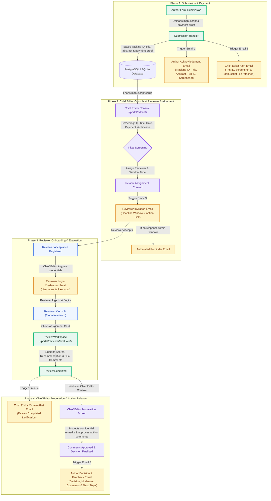
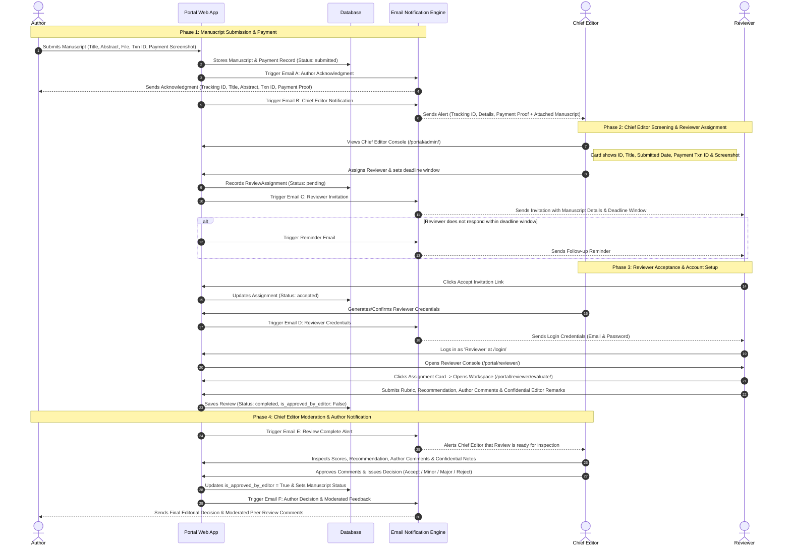

# PPAI / IJPP Manuscript Submission & Peer-Review Workflow

This workflow represents the end-to-end editorial pipeline for the **Indian Journal of Plant Protection (IJPP)** hosted by the **Plant Protection Association of India (PPAI)**.

> [!NOTE]
> The **Associate Editor** role is currently bypassed in this active operational pipeline. All editorial screenings, assignments, reviews, and decision releases route directly through the **Chief Editor Console**.

---

## 1. System Architecture & Flowchart

---

## 2. Detailed Sequential Workflow (Step-by-Step)

---

## 3. Workflow Specification Table

| Stage | Trigger Event | Action / Actor | Data Included | Automated Output / Email |
| :--- | :--- | :--- | :--- | :--- |
| **1. Submission** | Author clicks *Submit Manuscript* | Author uploads paper & payment proof | Tracking ID, Title, Abstract, Discipline, Txn ID, Screenshot | **Email to Author:** Submission confirmation with full details. **Email to Chief Editor:** Full alert with attached manuscript file. |
| **2. Admin Console** | Chief Editor logs into `/portal/admin/` | Chief Editor reviews card queue | Single card per paper: ID, Title, Submission Date, Author details, Payment Proof | Chief Editor verifies payment and manuscript scope. |
| **3. Assignment** | Chief Editor selects Reviewer & Window | Chief Editor assigns peer reviewer | Reviewer name, email, assignment due date (e.g. 14 days) | **Email to Reviewer:** Review invitation with time window. *(Auto-reminder triggered if not acknowledged)*. |
| **4. Credentials** | Reviewer accepts review invitation | Chief Editor issues login access | Reviewer portal credentials | **Email to Reviewer:** Login email, password, and portal URL. |
| **5. Evaluation** | Reviewer logs in & clicks card | Reviewer evaluates paper in `/portal/reviewer/evaluate/` | Rubric scores, Recommendation, Author comments, Confidential Editor notes | Submission saved as `completed`, confidential remarks locked to Chief Editor. |
| **6. Chief Editor Moderation** | Review submission triggers event | Chief Editor inspects review feedback | Reviewer scores, Author comments, Confidential remarks | **Email to Chief Editor:** Notification of review completion. |
| **7. Author Release** | Chief Editor approves feedback | Chief Editor releases editorial decision | Final decision (Accept / Revision / Reject), moderated review comments | **Email to Author:** Official decision letter with peer review comments. |
